# Pocket Orrery

An interactive 3D solar system in the browser. Planets sit where they really are today, you can fly to any of them, switch to true scale, listen to generated space music, and take a "Which planet are you?" quiz that shows what everyone else got.

The front end is one HTML file. Around it is a small production setup on AWS, built with Terraform, packaged with Docker, run on Kubernetes locally, and shipped by GitHub Actions. It costs about **$1 a month**.

## Architecture

```mermaid
flowchart LR
  user([Visitor]) -->|HTTPS| cf[CloudFront CDN<br/>security headers]
  cf -->|Origin Access Control| s3[(S3 bucket<br/>private)]
  user -->|quiz vote / stats| apigw[API Gateway<br/>HTTP API, throttled]
  apigw --> lambda[Lambda<br/>Python 3.13, arm64]
  lambda --> ddb[(DynamoDB<br/>on-demand)]
  lambda --> cw[CloudWatch logs<br/>+ error alarm]
  gh[GitHub Actions] -->|OIDC, no keys| s3
  gh --> ecr[(ECR<br/>Docker images)]
  dev[Your laptop] -->|docker / kind| k8s[Local Kubernetes<br/>2 nginx pods]
```



| Layer | What | Where |
|---|---|---|
| Front end | Three.js scene, quiz, Web Audio music | `site/` |
| API | `GET /stats`, `POST /vote` | `api/handler.py` (+ unit tests) |
| Infrastructure as code | S3, CloudFront, API Gateway, Lambda, DynamoDB, ECR, IAM, CloudWatch, SNS, Budgets | `infra/*.tf` |
| Container | nginx on Alpine Linux, non-root, health check, config injected at start | `docker/` |
| Kubernetes | Namespace, ConfigMap, Deployment (2 replicas, probes, limits, locked-down security context), NodePort Service | `k8s/` |
| CI/CD | Tests, `terraform validate`, shellcheck, image build, container smoke test, kind deploy, then deploy to AWS on `main` | `.github/workflows/ci.yml` |

## Cost

Estimates for light traffic in `us-east-1`; check the [AWS Pricing Calculator](https://calculator.aws/) for your case.

| Service | Monthly |
|---|---|
| S3 + CloudFront | ~$0–0.50 (CloudFront free tier covers 1 TB) |
| API Gateway + Lambda + DynamoDB | ~$0 at a few thousand votes (pay per request) |
| ECR (5 images max, lifecycle policy) | a few cents |
| CloudWatch logs (14-day retention), SNS, Budgets | ~$0 |
| Kubernetes | $0, it runs on your laptop |
| **Total** | **≈ $1** |

What keeps it cheap: no servers, no NAT gateway, no load balancer, no EKS. API Gateway throttling (10 req/s) caps abuse, and a budget alert emails you at 80% of $5.

## Run it

### 1. Docker (Linux container)

```bash
docker build -f docker/Dockerfile -t pocket-orrery:local .
docker run --rm -p 8080:8080 pocket-orrery:local
```

Open http://localhost:8080. Add `-e API_URL=<api_url>` to turn on live quiz stats.

### 2. Kubernetes (local only)

Needs [kind](https://kind.sigs.k8s.io/) or Kubernetes turned on in Docker Desktop.

```bash
bash scripts/k8s-local.sh        # build, deploy 2 pods, wait for rollout
bash scripts/k8s-local.sh down   # clean up
```

Open http://localhost:30080. The script only ever uses the `kind-pocket-orrery` or `docker-desktop` context.

### 3. AWS with Terraform

```bash
cp infra/terraform.tfvars.example infra/terraform.tfvars   # add your email
terraform -chdir=infra init
terraform -chdir=infra plan
terraform -chdir=infra apply
bash scripts/deploy-site.sh
terraform -chdir=infra output site_url
```

Confirm the two AWS emails (budget alert and SNS subscription).

Tear everything down with `terraform -chdir=infra destroy`.

### 4. CI/CD

Every push and pull request runs the tests and builds. To let `main` deploy to AWS:

1. Set `github_repo = "owner/name"` in `terraform.tfvars` and run `terraform apply`.
2. In GitHub → Settings → Secrets and variables → Actions → **Variables**, add the values from `terraform -chdir=infra output`:
   `AWS_DEPLOY_ROLE_ARN`, `SITE_BUCKET`, `DISTRIBUTION_ID`, `API_URL`, `ECR_REPOSITORY_URL` (and `AWS_REGION` if not `us-east-1`).

GitHub signs in to AWS with OIDC, so no AWS keys are stored in GitHub. That role can only upload the site, refresh CloudFront and push images. Infrastructure changes always go through a person running `terraform apply`.

## Security notes

- The S3 bucket is fully private; only this CloudFront distribution can read it.
- CloudFront and nginx send a strict Content Security Policy, HSTS, `nosniff` and `X-Frame-Options: DENY`.
- The Lambda role can only `Scan` and `UpdateItem` on its one table and write its own logs.
- The API accepts only the 8 planet names, bodies up to 1 KB, and browser calls from the site's own origin.
- Containers run as uid 101 with no Linux capabilities and no privilege escalation.
